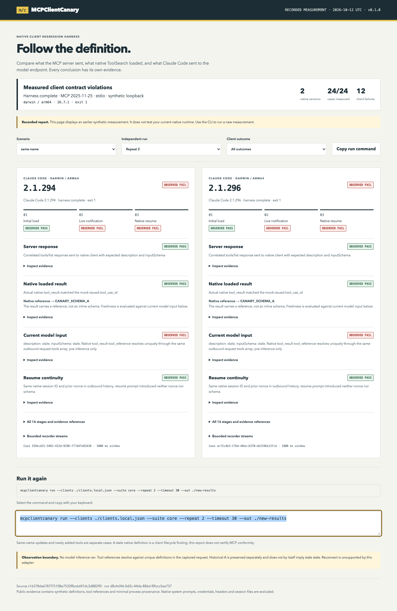

# MCPClientCanary

Reproduce native MCP client state regressions with evidence you can inspect.

A local CLI for one specific question: when a deferred MCP tool changes its description or input schema **without changing its name**, what does the real Claude Code CLI send to its next model request, including after resuming the same conversation?

MCPClientCanary launches two pinned, unmodified native executables against its own harmless stdio server and a loopback Messages/SSE endpoint. The endpoint drives genuine native ToolSearch calls. There is no paid inference in this verified synthetic mode.



[Recorded synthetic report](site/index.html) · [Play terminal recording](site/demo.html) · [Recording data](site/demo.cast) · [Portable CI definition](.github/workflows/portable.yml) · [Detailed measurement semantics](docs/measurement.md)

## What was measured

Experimental v0.1.0 supports **Claude Code 2.1.294 and 2.1.296, macOS arm64**. Each version runs from its own verified official distribution. Six scenarios run twice in independent owned directories: 24 native cases.

| Contract | 2.1.294 | 2.1.296 |
| --- | --- | --- |
| Initial deferred ToolSearch and pre-inference capture | Observed pass | Observed pass |
| Same-name A→B, after live notification | Observed stale A | Observed stale A |
| Same-name A→B, after native resume | Observed stale A | Observed stale A |
| Fresh B | Observed pass | Observed pass |
| A→A resume | Observed pass | Observed pass |
| Added tool | Observed pass | Observed pass |
| Description-only / schema-only changes | Separate stale fields | Separate stale fields |

This is an outcome of the pinned local experiment, not a claim about every release, MCP conformity, Claude Desktop, Cowork or hosted products. Both comparison columns may fail. Historical A in a request does not establish stale state if the unique current definition is B.

Four evidence layers stay separate:

1. **Server response:** correlated actual tools/list request and sent response; server PID, instance, generation and separate definition hashes.
2. **Native loaded result:** real ToolSearch tool_result matching the issued tool_use_id. Native tool_reference blocks are retained.
3. **Current model input:** the unique definition in that same outbound request's tools array. References resolve through this array; no server-side inference or hidden resolution is assumed.
4. **Resume continuity:** the native session ID is unchanged and prior synthetic nonce remains in outbound history. The harness does not reintroduce it.

## Install the release package

Requires Node.js **22.16+ or 24 LTS**, macOS on Apple Silicon, and a license to use Claude Code. No Anthropic login or API key is needed for the synthetic experiment. Other platforms can develop and run portable tests, but native support is unverified.

Download the `.tgz` from this repository's **Releases** into a new consumer folder. The package contains compiled JavaScript, the fixture server, schemas and examples; it does not contain a vendor executable.

```sh
mkdir canary-consumer
cd canary-consumer
npm init -y
gh release download v0.1.0 --repo mikonyaa/mcpclientcanary --pattern '*.tgz'
npm install --ignore-scripts ./mcpclientcanary-0.1.0.tgz
./node_modules/.bin/mcpclientcanary --version
```

The local `node_modules/.bin` invocation uses the installed package. Registry `npx mcpclientcanary` is not supported: this release is distributed through GitHub, not npm's registry.

## Acquire the pinned native clients explicitly

The included helper downloads the exact **official** darwin-arm64 bytes from the release service used by [Anthropic's installer](https://claude.ai/install.sh). It checks the official manifest and this adapter's pinned hashes, writes only a new owned cache and a local manifest, and does not execute install, update, login or logout. A partial or existing cache is refused; choose a fresh directory.

```sh
node node_modules/mcpclientcanary/examples/acquire-clients.mjs \
  --cache ./canary-native-cache --manifest ./clients.local.json
./node_modules/.bin/mcpclientcanary doctor --clients ./clients.local.json --json
./node_modules/.bin/mcpclientcanary run --clients ./clients.local.json \
  --suite core --repeat 2 --out ./core-results
```

The two verified upstream releases are [v2.1.294](https://github.com/anthropics/claude-code/releases/tag/v2.1.294) and [v2.1.296](https://github.com/anthropics/claude-code/releases/tag/v2.1.296). Keep their executable paths separate. Doctor verifies realpath, SHA-256, --version, required --help flags, and clean config/auth identity. Its local manifest contains personal paths and must not be published. `--allow-unverified` is diagnostic: it leaves the run unverified and cannot yield complete supported coverage.

## Commands

```sh
mcpclientcanary init --dir ./canary-example
mcpclientcanary doctor --clients ./clients.local.json --json
mcpclientcanary run --clients ./clients.local.json --scenario same-name --out ./results
mcpclientcanary run --clients ./clients.local.json --suite core --out ./core-results
mcpclientcanary report ./results/report.json --out ./new-report.html
mcpclientcanary demo --clients ./clients.local.json --out ./demo-results
mcpclientcanary demo --recorded --out ./recorded-results
```

Add the installed `node_modules/.bin` to your shell's command resolution or use its explicit path as above. `init` creates placeholders; it never silently downloads clients. Ordinary `demo` runs native clients. `demo --recorded` renders a dated packaged measurement and explicitly says it has not checked your runtime. Reports open directly via `file://`, use no CDN or network fonts, and never open automatically. `--no-open` is accepted for scripting. `--json` keeps stdout machine readable; progress uses stderr.

`--timeout 5..90` is the deadline in seconds for each native phase. `--repeat 1..3` selects independent cases; default is 2. Versions run sequentially. Maximum 12 model requests and 16 MiB total request capture per case; a 15-minute suite deadline cancels owned work. Capture overflow, malformed protocol or drift is an error, not a green empty report.

Outputs: `report.json`, standalone `report.html`, and `junit.xml`. Output reports refuse to overwrite existing files. Open each conclusion to inspect synthetic evidence and references. JUnit failures describe measured client violations; errors describe harness failures; skipped cases mean missing coverage.

| Exit | Meaning |
| --- | --- |
| 0 | All selected mandatory contracts measured and passed |
| 1 | Measured client lifecycle contract violation |
| 2 | Input, launch, I/O or protocol harness error |
| 3 | Unsupported or incomplete observation |
| 130 | Cancellation |

Priority is 2 → 3 → 1 → 0; explicit cancellation is 130. A trustworthy detector that returns 1 can pass its acceptance tests. Those tests check the actual exit and recompute evidence; they do not ignore failures.

## Scenarios and limits

`same-name` changes both description and schema from A1 to B2. `description-only` and `schema-only` isolate the fields. `fresh-b` starts independently in B; `no-change` holds A through notification and resume; `added-tool` keeps lookup_record in A and adds lookup_summary. Discovery of a new name cannot upgrade a same-name verdict.

The observer waits a predeclared 1,000 ms after confirmed notification send, then completes the next native turn and gets an explicit fixture recorder checkpoint. Notification send proves send, not receipt. No immediate re-list obligation is attributed to MCP. A fully observed missing re-list plus stale current definition can fail this harness's lifecycle contract. Lost events, an unresolved reference, missing trigger or unproved resume instead remain incomplete. [Measurement details](docs/measurement.md) define those barriers and the supported protocol.

Reconnect has no verified native headless control in this adapter and is **not supported**. A resumed server process is expected and reads saved B. It is not reported as reconnect. No arbitrary user server, HTTP/OAuth transport, external model URL or paid inference mode is accepted.

## Privacy and isolation

Each case owns new project/config/control directories. The same case retains them through native --resume; other versions and repeats share no state. Child environments use an allowlist, remove inherited provider credentials, proxies, preloads and IDE bridges, and set a synthetic credential only for 127.0.0.1. The endpoint has no fallback. ENABLE_TOOL_SEARCH=true is explicit; the inherited experimental-beta disable flag is excluded. Telemetry, memory and updating are disabled in the child scope.

The documented CLAUDE_CONFIG_DIR also separates macOS credential namespaces. Doctor checks that the isolated config has authMethod none before the dummy token is installed. Managed policy is not edited or bypassed. Global HOME, CODEX_HOME, profiles, existing installations and unrelated processes are unchanged. This is configuration isolation, **not a measured network air gap**.

Requests are processed in memory. The public projection preserves only our synthetic tools, correlated reference blocks, continuity booleans and minimal process provenance. It excludes native system prompts, headers, credentials, full transcripts and personal paths. Private raw capture is not provided. Owned config/session directories are deleted after observation; bounded synthetic recorder files remain for inspection. Controlled parent credential/proxy/preload canaries are part of native acceptance.

## Development

```sh
npm ci
npm run build
npm run typecheck
npm run lint
npm run test:unit
npm run test:server
npm run test:ui
npm run test:package
npm run test:native -- --clients ./clients.local.json
npm pack --json
```

Playwright's managed Chromium is needed for `test:ui`; explicitly provision it with `npx playwright install chromium` on a development machine if absent. Portable CI provisions Chromium on its disposable runner. Lint includes strict TypeScript unused-symbol checks and a boundary guard. Server tests use an independent official SDK client and are labeled server checks, not native coverage.

Architecture: CLI → pinned native adapter + owned state machine → loopback Messages driver / official SDK stdio fixture → bounded evidence resolver → contract verdicts → JSON/HTML/JUnit. TypeScript strict; Node built-in HTTP and process APIs; Zod; Commander. [Baseline comparison](docs/baseline.md), [troubleshooting](docs/troubleshooting.md), [contribution](CONTRIBUTING.md), [security](SECURITY.md).

Portable GitHub checks cover unit/observer/server/package/UI behavior. Native verification is local on a Mac, with the final CI-built package installed in a clean consumer. The release manifest identifies source commit, exact asset bytes, CI run and native verification origin. A portable green workflow alone does not mean native tests ran in Actions.

## License

MIT for original code and fixtures. Runtime dependency licenses are listed in [NOTICE](NOTICE). Vendor executable acquisition is separate and governed by Anthropic's terms. No source is copied from the unlicensed compatibility probe.
